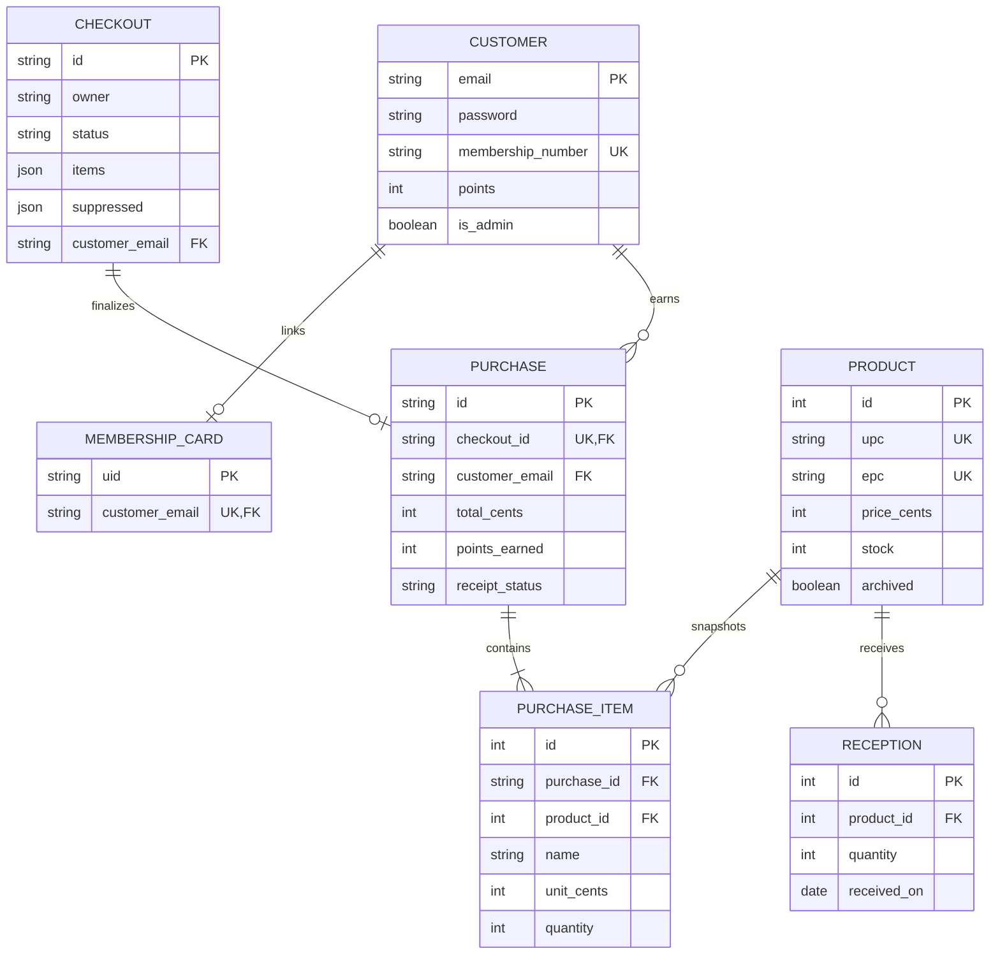

# Phase 3 design and discovery

## CF600 integration update (2026-11-12)

Target: Raspberry Pi 5 Model B Rev 1.1, Debian 13 ARM64. Initial keyboard-mode
integration was based on an unverified output assumption; no keyboard events
were observed. The teacher's guide specifies CDC-COM. Loading `usbserial` with
vendor 0483/product 5750 exposed the reader's interface 03 as a serial port.
A passive 57600-baud capture received binary inventory frames and identified
`A00000000000000000004965` with a valid CRC.

The selected backend is now `cf600_serial`, using the stable by-id port.
`hardware/cf600_serial.py` buffers fragmented/coalesced CF-header packets,
validates CRC/status/length and returns uppercase EPCs through `start/poll/stop`.
It sends no commands and preserves the reader configuration. Leases, ownership,
deduplication and independent expiry remain shared in ProductReader. The HID
backend remains optional for devices verified to emit Tab-framed keystrokes.

The observed protocol matches [the inventory frame and CRC specification](https://electron.id/protocol/el-uhf-rc4-protocol/):
CF/address/two-byte command/one-byte payload length, then status, RSSI, antenna,
channel, EPC length/EPC and two CRC bytes. Accepted inventory command is 0001,
status zero, with exact length and at most 12 EPC bytes. CRC is reflected 8408,
initial FFFF, stored high byte first. No raw substring or tag suffix matching is
used. No full product mappings are seeded; other tags and physical all-four
inventory still require confirmation.

The CF-RU5114 archive contains Windows DLLs and an older serial protocol manual;
that protocol does not match these captures. Earlier discovery below is historical.

## Historical discovery (2026-11-10)

All three local references are present and inspected: Phase-3.pdf,
ESP32-RFID.pdf and RFID_TAGS.jpeg. They remain ignored local assets; supply
them separately in another checkout. The photograph identifies suffixes 4965,
4970, 4968 and 4951. Full EPC zero counts have **not** been reader-confirmed;
no production mapping is seeded from an uncertain transcription.

The development host is Linux x86_64, not verified as the target Pi. No CF600
SDK, Arduino CLI, reader transport information or physical scan captures were
found. Owner: project operator must download the Omnivox SDK, record Pi model,
OS/architecture, connection method and sample command/output. A native adapter
cannot be selected responsibly before this evidence exists. Product names,
UPCs, prices, producers, initial quantities and barcode scanner type also need
operator confirmation. Software supports keyboard-wedge UPC input provisionally.
The RC522 wiring is specified in the guide; actual board, cards, UID lengths,
Wi-Fi/MQTT and live receipt delivery remain unverified. No credentials or live
device changes are needed for automated tests.

## Policies

* Money is CAD integer cents, no tax calculation. Prices must be positive,
  at most 999999.99, with at most two decimal places.
* Register exactly one full uppercase hex EPC per product (2–24 even hex
  characters); UPC is 1–13 ASCII digits. Preserve leading zeros. Reader EPC bytes/text are normalized to uppercase without byte reversal; physical
  values must still be reader-confirmed. Membership UIDs are
  separate uppercase hex strings of 4, 7 or 10 bytes.
* Registering a tag creates no stock. Positive dated receptions increase the
  cached stock counter and append an immutable reception. Completed sales
  decrease it. Tags remain reusable. Each unique EPC adds one unit on first observation;
  RFID polling preserves subsequent quantity edits. Barcode scans increment
  quantities and +/− controls adjust them, capped at stock on increases.
  Decreasing to zero removes and suppresses the product. A deliberate barcode
  scan or explicit restore adds it back; passive RFID reports do not.
* Snapshot names/prices and preserve quantities at review. If price or availability changes, refuse
  payment and require another review. Atomic conditional updates deduct the full line quantity and prevent
  overselling; checkout state compare-and-set and a unique purchase checkout
  key prevent duplicate payment. Email is outside that transaction.
* Members earn floor(total cents / 100) points per purchase. Guests earn zero.
  Card identification alone grants no authentication or history access.
* Public signup never creates administrators. An explicit local CLI command
  promotes an existing customer. All mutations require CSRF; admin routes and
  fridge threshold mutations require authenticated administrators.
* Products with reception or sale history are archived, retaining ledger
  integrity. Unused products can be deleted. Account deletion is not exposed.
* Receipt snapshots include recipient and language. Guest receipts require
  the checkout browser capability; member history additionally requires login.
* One serving process owns each physical reader and fan. Reader leases last
  60 seconds. A random server-session ID owns operations and carts; logout
  invalidates leases and rotates the session. Development fake inputs require
  an explicit configuration switch. No hardware opens during app construction.

## Schema

Legacy customer email keys and password hashes are preserved. Versioned,
repeatable migration adds membership/points/admin fields and indexes, then
creates new tables. Back up first; MySQL DDL is not transactional. SQLite and
MySQL are supported dialects; actual MySQL execution remains an operator check.

## Membership MQTT contract v1

Dedicated topics (never Frig1/# or Frig2/#):

* `SmartShop/membership/command`: backend → one reader, QoS 1, non-retained.
  Arm: `{"v":1,"action":"arm","operation_id":"uuid","purpose":"enroll",
  "reader_epoch":"connection-uuid","expires_at":1790000060}`.
  Purpose is `enroll` or `checkout`. Cancel carries the same operation_id and
  reader_epoch with action `cancel`.
* `SmartShop/membership/event`: reader → backend, non-retained, QoS 0:
  `{"v":1,"operation_id":"uuid","event_id":"unique-uuid",
  "reader_epoch":"connection-uuid","uid":"00010203"}`.
* `SmartShop/membership/status`: reader heartbeat every 5 seconds,
  non-retained, QoS 0: `{"v":1,"online":true,"reader_epoch":"connection-uuid"}`.
  LWT has online=false. Backend requires a heartbeat within 15 seconds.

Both sides use clean MQTT sessions; every reader reconnect generates a new
epoch, invalidates the old arm, and requires a new operation. Backend accepts
only one matching event for its active owned operation, rejects retained,
malformed, stale and wrong-epoch messages, expires after 60 seconds, and
invalidates on broker/reader disconnect, cancel, logout or completion. Reader
requires NTP time and rejects expired commands. It requires card absence after
arming before accepting a fresh presentation. Enrollment/replacement requires
authenticated explicit confirmation. Checkout requires separate explicit
confirmation of the selected loyalty member, or guest choice.

Deploy on a trusted broker with per-client ACLs: backend publishes commands,
reader publishes events/status; ordinary clients cannot inject either. Never
retain commands/events. Use TLS outside a trusted isolated LAN. UID cards are
loyalty identifiers, not authentication credentials.

Firmware APIs checked against [MFRC522 upstream](https://github.com/miguelbalboa/rfid)
and [PubSubClient API](https://pubsubclient.knolleary.net/api). The historical
PDF patch is not applied. Actual board compilation and physical verification
remain separate checks.

## Checkout barcode and quantity update

`POST /checkout/<cart_id>` accepts `action=barcode` with `upc`, and
`action=increase|decrease` with `product_id` while scanning. Existing ownership,
CSRF and checkout locking apply. Repeated barcodes add one unit, EPC observations
add only absent lines, and manual quantities survive subsequent polling.
The existing JSON `quantity` and PurchaseItem quantity fields support this
without a schema migration. All totals and points use unit price times quantity.
Review checks the full quantity, and finalization atomically deducts it or rolls
back the entire sale if stock or price changed. Barcode scans can use Enter/Tab
terminators or the visible submit button.
